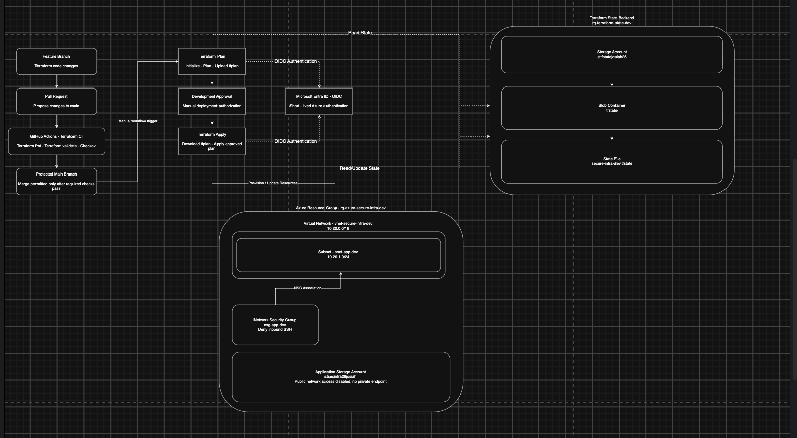

## Project Overview
This project demonstrates the design and implementation of secure Azure infrastructure using Terraform and automated CI/CD workflows through GitHub Actions. 

This environment includes Azure networking, Network Security Groups, secured storage resources, and a separate Azure Blob Storage backend for Terraform state management. Infrastructure changes are validated through Terraform and Checkov security scanning, with OIDC-based authentication and approval controls used to secure deployment workflows.

This project emphasizes Infrastructure as Code (IaC), security automation, controlled deployments, and infrastructure testing and remediation.

## Project Objectives
- Provision and manage Azure infrastructure using Terraform, including virtual networks, subnets, Network Security Groups, and secured storage.
- Configure a remote Terraform state backend using Azure Blob Storage to support centralized infrastructure state management.
- Implement GitHub Actions CI/CD workflows to automate Terraform validation, security scanning, and controlled deployments.
- Integrate Checkov to identify infrastructure security misconfigurations before changes are merged.
- Secure GitHub Actions authentication to Azure using Microsoft Entra ID and OpenID Connect (OIDC), eliminating the need for long-lived Azure client secrets.
- Enforce infrastructure change controls through pull request reviews, branch protection, and deployment approvals
- Validate security controls through infrastructure testing, misconfiguration detection, and remediation.

## Technologies
- Cloud Platform: Microsoft Azure
- Infrastructure as Code (IaC): Terraform
- CI/CD & Version Control: GitHub Actions, Git, GitHub
- Security & Identity: Checkov, Microsoft Entra ID, OpenID Connect (OIDC)
- Azure Networking: Virtual Networks (VNets), Subnets, Network Security Groups (NSGs)
- Storage & State Management: Azure Storage Accounts, Azure Blob Storage, Terraform Remote State
- Command-Line Tools: Azure CLI, Terraform CLI

## Project Architecture

This project uses a Terraform-based infrastructure architecture integrated with GitHub Actions for automated validation, security scanning and controlled Azure deployments.

The architecture separates infrastructure provisioning, authentication, Terraform state management, and Azure resources into distinct components.

### Architecute Components

- **GitHub Actions CI/CD:** Automates Terraform validation, Checkov security scanning, controlled infrastructure deployments through pull requests and approval workflows.
- **Microsoft Entra ID & OIDC:** Establishes federated authentication between GitHub Actions and Azure, allowing workflows to obtain short-lived credentials without storing long-lived Azure client secrets.
- **Terraform:** Defines the Azure infrastructure as code, generates execution plans, and provisions or updates resources through controlled deployment workflows.
- **Terraform Remote State Backend:** Stores Terraform state in an Azure Blob Storage container within a separate resource group (rg-terraform-state-dev). Terraform uses this state to track and manage provisioned infrastructure.
- **Azure Application Infrastructure:** Contains the virtual network, subnet, Network Security Group, and secured Storage Account within rg-azure-secure-infra-dev.

## Infrastructure Security Design

The environment incorporates multiple security controls, including restricted inbound network traffic through NSG rules, disabled public network access on the application Storage Account, automated infrastructure security scanning, and approval requirements for infrastructure deployments.

Separating Terraform state storage from the application infrastructure also establishes a distinct management boundary for infrastructure state.

- Azure Resource Group for centralized resource organization.
- Virtual Network (10.20.0.0/16) and application subnet (10.20.1.0/24) for network segmentation.
- Network Security Group with an explicit inbound SSH denial rule.
- Secured Azure Storage Account with HTTPS enforcement, minimum TLS 1.2, disabled Shared Key authorization, restricted public access, and blob soft delete.
- Configurable input variables and resource outputs to support infrastrucutre maintability.

### Remote State Management

Terraform state is stored remotely using an Azuree Blob Storage backend within a separate resource group.

The remote backend provides:

- Centralized infrastructure state management.
- State locking to prevent conflicting infrastructure modifications.
- Microsoft Entra ID-based authentication.
- Separation of infrastructure state from application resources
- Consistent state management across local and automated Terraform operations.

Terraform and AzureRM provider version constraints are defined to maintain configuration compatibility and reduce unexpected changes.

GitHub Actions is used to automate infrastructure validation, security scanning, and controlled Azure deployments. The automation architecture separates continuous integration, infrastructure delivery, and authentication testing into three independent workflows.

### Continuous Integration

The Terraform CI workflow is triggered by pull requests targeting the main branch and performs the following checks:

- Checkov infrastructure security and misconfiguration scanning.
- Terraform code formatting validation.
- Terraform initialization without remote backend access.
- Terraform configurtion validation.

This integrates security testing into the infrastructure development lifecycle, allowing misconfigurations to be identified before deployment.

### Continuous Delivery

The Terraform Delivery workflow is manually initiated and restricted to execution from the main branch.

The workflpw separates infrastructure deployment into two stages:

- **Terraform Plan:** Authenticates to Azure, initializes the remote backend, generates an execution plan, and uploads the saved plan as a GitHub Actions artifact.
- **Terraform Apply:** Executes after successful planning and is associated with the development environment approval gate. The workflow downloads and applies the previously generated Terraform plan.

Plan artifacts are retained for one day to limit unnecessary exposure of potentially sensitive infrastructure information.

### Secure Authentication OIDC

Microsoft Entra ID and OpenID Connect (OIDC) establish federated authentication between GitHub Actions and Azure without requiring long-lived Azure client secrets.

A dedicated authentication test workflow verifies:

- Federated authentication to Microsoft Azure.
- Management-plane access to the application resource group.
- Data-plane access to the remote Terraform state blob uing Microsoft Entra ID authentication.

This appraoch reduces credential management risks and establishes authenticated access for automated infrastructure operations.